# Dola Toolkit · 多拉工具箱

> **beta 0.0.1** — 一个 **Material You（MD3 / Material Design 3）** 风格的 Windows 桌面工具箱。
> 左侧可拖拽工具栏、内置多套莫奈配色、Xray / Mihomo / Sing-box 三内核代理、
> 支持 EPUB / PDF / FB2 / MOBI / TXT / RTF 的自适应双页阅读器。


---

## 界面预览

| 首页（工具栏收起） | 首页（工具栏展开） |
| --- | --- |
| 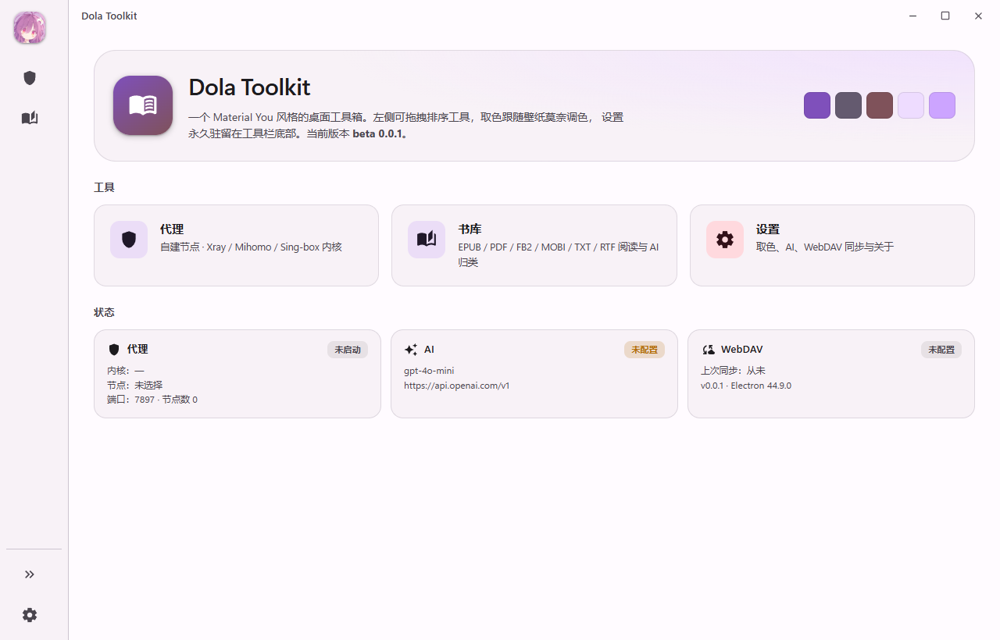 | 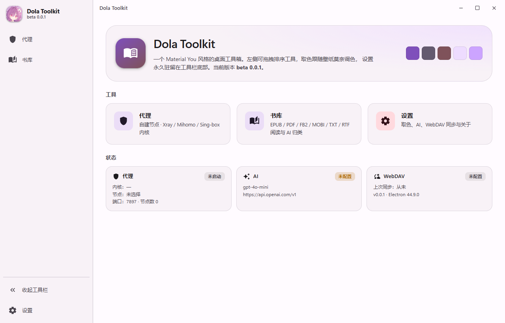 |

| 代理 | 添加节点（按协议动态显示字段） |
| --- | --- |
| 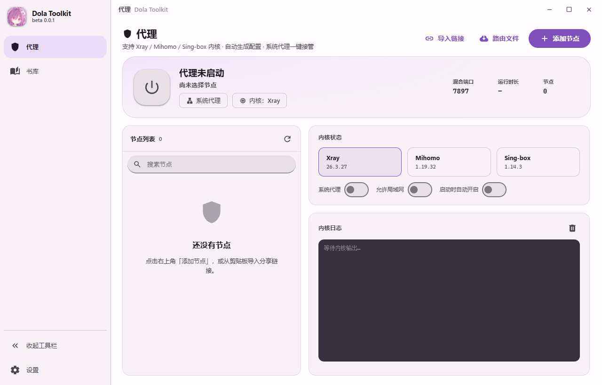 | 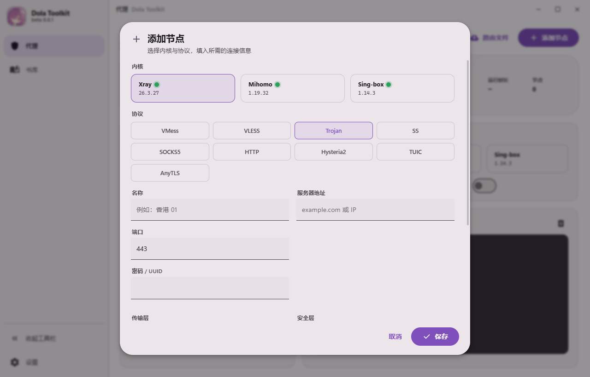 |

| 书库（网格） | 免费书源（Gutendex / Open Library / Standard Ebooks） |
| --- | --- |
| 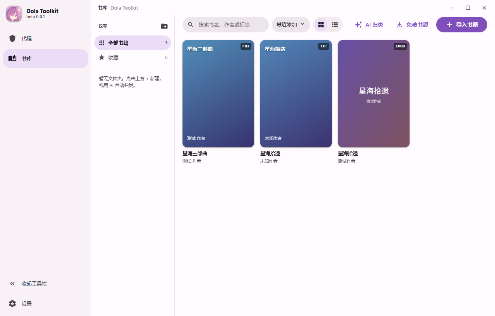 |  |

| 阅读器 · 宽窗口双页 | 阅读器 · 窄窗口单页 |
| --- | --- |
| 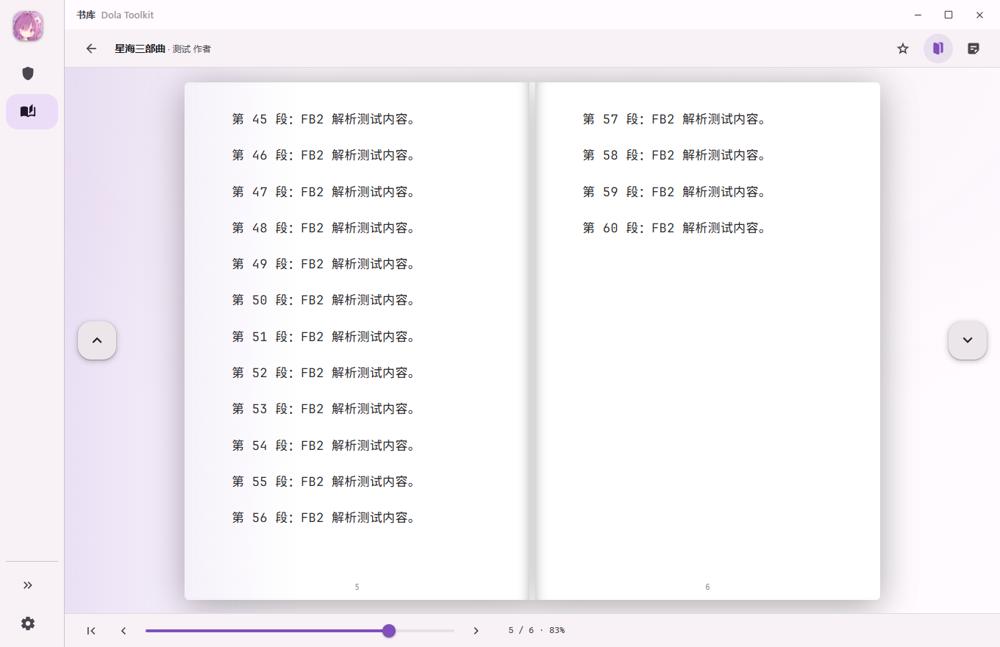 | 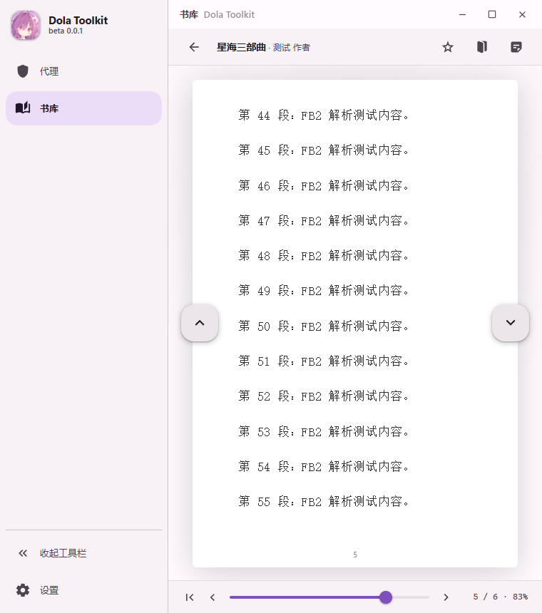 |

| 设置 · 主题配色 | 设置 · AI 助手 |
| --- | --- |
| 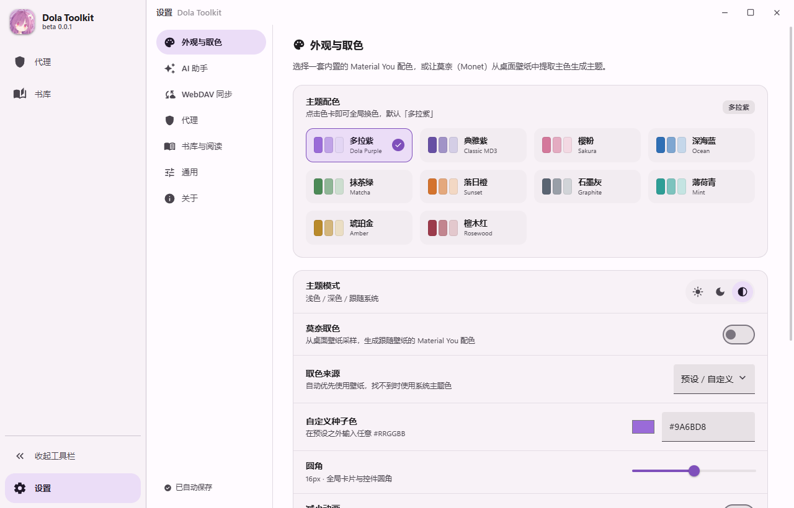 | 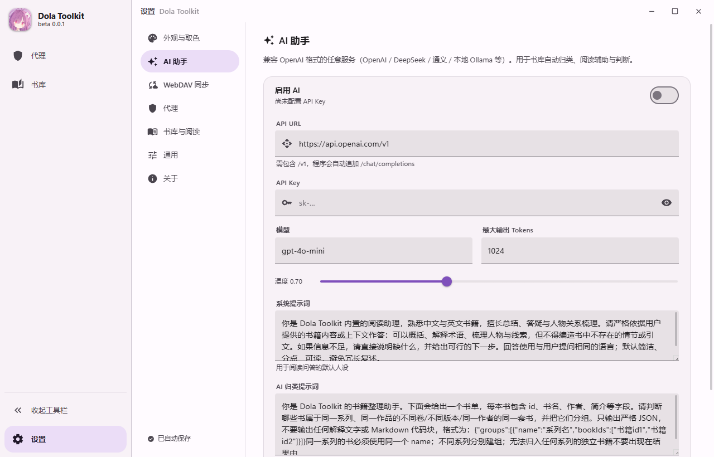 |

| 设置 · WebDAV 同步 | 深色模式 |
| --- | --- |
|  | 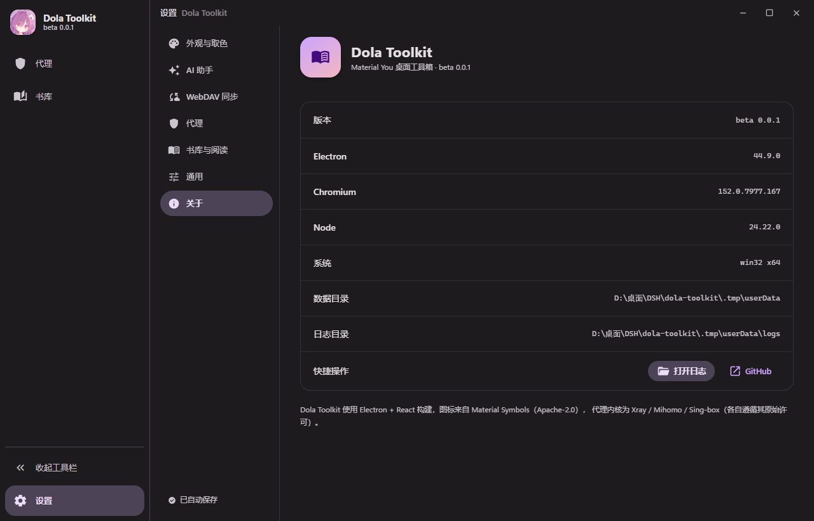 |

| 设置 · 外观与字体 | 设置 · 书库与翻页 |
| --- | --- |
|  | 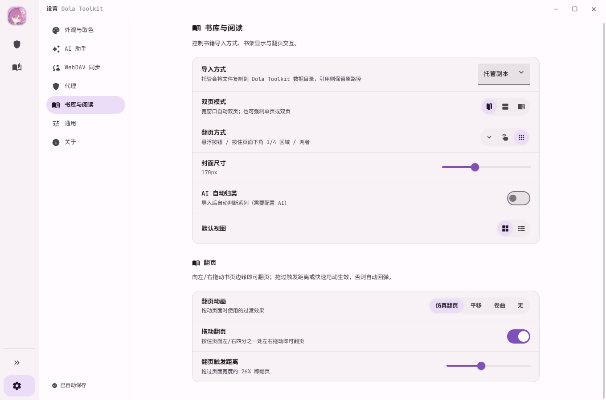 |

| 翻页动画 · 仿真 | 翻页动画 · 平移 | 翻页动画 · 卷曲 |
| --- | --- | --- |
| 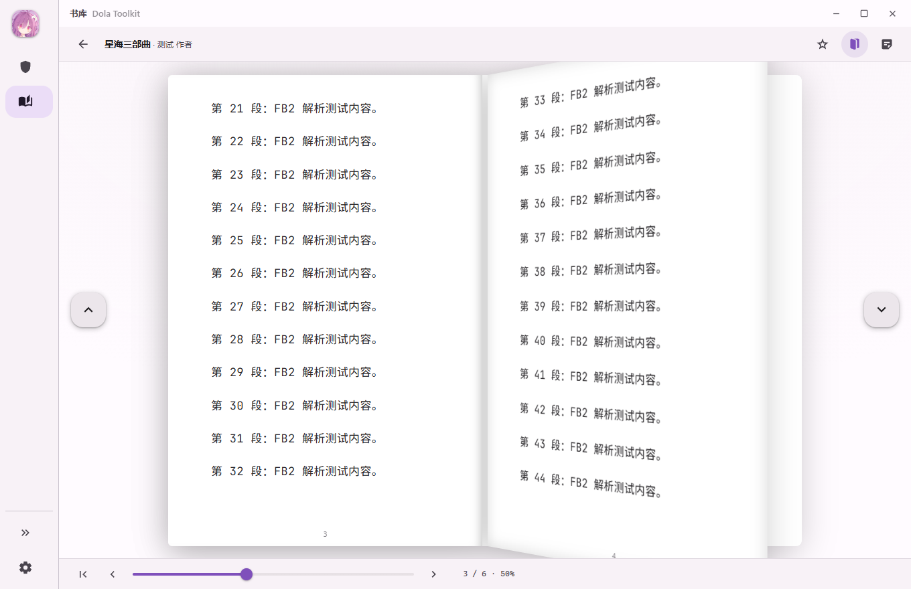 | 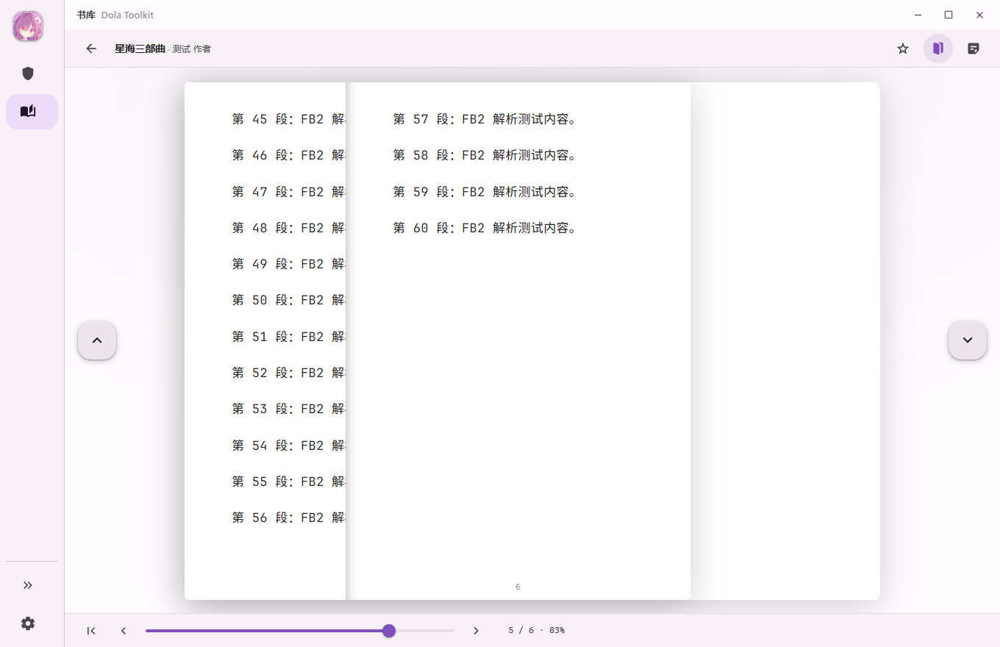 | 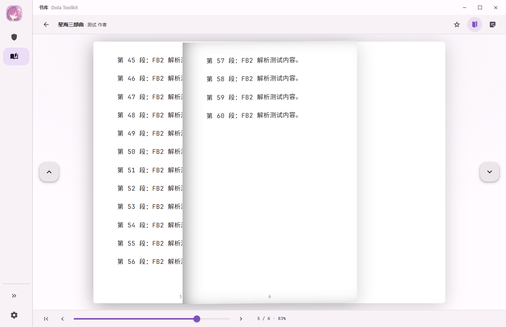 |

---

## 界面

- 无边框窗口 + 自绘标题栏，整体为原生安卓 MD3 视觉（Material Symbols Rounded 图标）。
- **左侧竖直工具栏**：收起时**仅显示图标**，每个图标都是 **52×52 正方形**热区，App 图标与所有工具图标严格居中于同一条轴线（左右留白相等）；
  点击底部展开按钮后略微展开，显示工具名称。
- **工具栏内工具可自由上下拖拽排序**（仅限工具栏区域内），顺序会被记住。
- **设置永久固定在工具栏最下方**，即使工具多到需要滚动，也始终可见。
- **内置 10 套 MD3 配色**（默认「多拉紫」），也可切换「莫奈取色」从桌面壁纸实时取样生成主题。
- 支持浅色 / 深色 / 跟随系统、圆角与减弱动画调节。

### 内置主题配色

| 配色 | 种子色 | 配色 | 种子色 |
| --- | --- | --- | --- |
| 多拉紫 Dola Purple（默认） | `#9A6BD8` | 典雅紫 Classic MD3 | `#6750A4` |
| 樱粉 Sakura | `#D4789B` | 深海蓝 Ocean | `#2F6FB5` |
| 抹茶绿 Matcha | `#4C8A57` | 落日橙 Sunset | `#D4732E` |
| 石墨灰 Graphite | `#5A6472` | 薄荷青 Mint | `#2E9E96` |
| 琥珀金 Amber | `#B98A2B` | 檀木红 Rosewood | `#9C3B4B` |

## 工具

### 1. 代理

参考 v2rayN 的「自行添加节点」工作流，由 Dola Toolkit 直接驱动三个内核。

| 能力 | 说明 |
| --- | --- |
| 内核 | **Xray** / **Mihomo**（Clash Meta）/ **Sing-box**，可按节点分别选择 |
| 协议 | VMess、VLESS、Trojan、Shadowsocks、SOCKS5、HTTP、Hysteria2、TUIC、AnyTLS、WireGuard |
| 传输 | TCP / WebSocket / gRPC / HTTP / H2 |
| 安全 | none / TLS / **REALITY**（publicKey、shortId、fingerprint、spiderX） |
| 添加节点 | 弹出小窗，按所选**内核 + 协议动态显示**需要填写的字段 |
| 保存后 | 自动生成对应内核配置（Xray JSON / Sing-box JSON / Mihomo YAML）并启动 |
| 批量导入 | 粘贴 `vmess://` `vless://` `trojan://` `ss://` `hysteria2://` `tuic://` 分享链接 |
| 系统代理 | 一键写入/恢复 Windows 系统代理（会快照并还原用户原有设置） |
| Geofiles | 导入本地 `geoip.dat` / `geosite.dat`，或在线更新 |
| 其它 | 延迟测试、出口 IP、实时内核日志、局域网共享、嗅探、异常自动重启 |

### 2. 书库

| 能力 | 说明 |
| --- | --- |
| 格式 | **EPUB / PDF / FB2 / MOBI / TXT / RTF**（AZW3 尽力支持） |
| 导入 | 文件对话框或直接拖拽；自动提取书名、作者、语言、简介、封面与封面色 |
| AI 归类 | 用预设提示词按书名判断是否同一系列/同一部作品，自动建「系列」文件夹归档 |
| 手动分类 | 像文件管理器一样新建文件夹、建子文件夹、重命名、删除 |
| **双页自适应** | **窗口宽比例 → 显示两页，翻页直接跳到下两页；窄比例 → 显示一页，翻到下一页**（按实际渲染高度分页，不截断文字） |
| **拖动翻页** | **按住书页左下角 / 右下角**向另一侧拖动：右下角向左拖=下一页，左下角向右拖=上一页。书页**跟随鼠标 1:1 移动**；拖过阈值（默认页面宽度的 26%）或快速甩动生效，否则带轻微回弹复位。**一次拖动只翻一个跨页**（双页模式前进两页），动画进行中最多排队一次，滚轮惯性被 520ms 去抖，不会连翻。**EPUB / PDF / TXT / FB2 / MOBI / RTF 全部支持** |
| **翻页动画** | 由 **requestAnimationFrame 逐帧驱动**（不依赖 CSS 过渡）。**仿真翻页**以**装订线为轴**：双页模式下右页从书缝揭开、扫过左半页，露出下两页——与 PTQBookPageView / iOS 书页手感一致，带纸张卷曲高光与投影。**点按钮 / 方向键翻页同样播放完整动画**。另有平移、卷曲、无 三种可选 |
| 其它翻页方式 | 左右悬浮 **< / >** 按钮、方向键、滚轮、底部进度条。**点击页面本身不会翻页**（翻页只有「按钮」与「拖动」两种） |
| 阅读体验 | EPUB 内嵌图片、PDF 矢量渲染、TXT 编码自适应（UTF-8/GBK/GB18030）、MOBI/RTF 文本抽取 |
| 其它 | 阅读进度记忆、收藏、搜索、排序、封面尺寸调节 |
| 免费书源 | 内置 **Gutendex** / **Open Library** / **Standard Ebooks** 三个公有领域书籍 API，可直接搜索并导入 |

### 3. 设置（永远在工具栏最下方）

- **外观与取色**：10 套内置配色、莫奈取色开关、取色来源、自定义种子色、主题模式、圆角、减少动画，以及 **字体**（全软件生效）。

- **AI 助手**：任意 OpenAI 兼容服务（**API URL / API Key** / 模型 / 温度 / 最大 Tokens / 系统提示词 / 归类提示词），支持一键测试与试聊。
- **WebDAV 同步**：为后续多端同步打基础，可测试连接、立即同步设置与书库元数据。
- **代理**：混合端口、默认内核、日志等级、绕过列表、嗅探、IPv6、自动重启。
- **书库与阅读**：导入方式（托管副本 / 引用原文件）、双页策略、翻页方式、封面尺寸、AI 自动归类，以及 **翻页**（动画 / 拖动开关 / 触发距离）。
- **通用**：语言、关闭行为、开机自启、重置设置。
- **关于**：版本、Electron / Chromium / Node、数据与日志目录。

---

## 技术栈

| 层 | 技术 |
| --- | --- |
| 容器 | Electron 44（无边框窗口 + 自绘标题栏 + contextIsolation） |
| 构建 | electron-vite 6 + Vite 8 |
| 界面 | React 19 + TypeScript 5.9（严格模式） |
| 状态 | Zustand |
| 取色 | `@material/material-color-utilities`（HCT / Monet） |
| 样式 | 原生 CSS 变量驱动的 MD3 设计令牌，无 UI 框架 |
| 阅读 | **epub.js**（EPUB）、pdfjs-dist（PDF）、自研 FB2 / RTF / MOBI 解析 |
| 字体 | 内置 JetBrains Maple Mono NF（woff2 中文子集，约 10MB / 5.2MB×2），经自定义 dola-font:// 协议按需流式加载；选中后对**整个界面**生效 |
| 打包 | electron-builder（portable exe，x64） |

## 开发

```bash
npm install
npm run dev        # 开发模式
npm run build      # 编译
npm run dist       # 打包 portable exe → dist/
npm run dist:full  # 编译 + 打包 + 拷贝内核 + 复制到交付目录
```

> 构建脚本默认复用本地已安装的 Electron（`electronDist`），
> 因此不需要从 GitHub 重新下载 Electron。

### 代理内核（不随仓库提供）

二进制体积约 200 MB，且各项目许可不同，请自行放入以下位置之一：

```
# 方式 A：可执行文件同级目录（推荐，portable 版就是这样分发的）
<exe 所在目录>/
  DolaToolkit.exe
  cores/
    xray/xray.exe
    mihomo/mihomo.exe
    singbox/sing-box.exe
    geofiles/geoip.dat
    geofiles/geosite.dat

# 方式 B：项目内（开发时）
cores/
  xray/xray.exe
  mihomo/mihomo.exe
  singbox/sing-box.exe
  geofiles/{geoip.dat,geosite.dat}
```

运行时按 `resources/cores` → exe 同级 `cores` → `D:\桌面\server\tool` 顺序查找。
`npm run dist:full` 会用 `scripts/copy-cores.mjs` 自动把内核放到 exe 旁边
（**不嵌入 exe**，避免 portable 版每次启动都解压 200MB 到临时目录）。

## 目录结构

```
src/
  main/       主进程：窗口、设置存储、莫奈取色、代理内核管理、书库、AI、WebDAV
  preload/    contextBridge 安全桥（IPC 白名单）
  renderer/   React 界面：MD3 令牌、工具栏、代理页、书库页、阅读器、设置页
  shared/     主进程与渲染进程共享的类型契约、通道名、版本号、内置配色
cores/        代理内核与路由文件（不入库）
scripts/      图标生成、测试夹具、截图 / 校验脚本、发布打包
docs/         截图
```

## 脚本

| 命令 | 作用 |
| --- | --- |
| `node scripts/gen-icon.mjs` | 从 `ico.jpg` 生成多分辨率 `icon.ico` / `icon.png` 与 App 内 logo |
| `node scripts/run-app.mjs` | 以调试端口启动已构建的应用 |
| `node scripts/shots.mjs` | 通过 CDP 截图所有页面 |
| `node scripts/verify-responsive.mjs` | 校验阅读器宽/窄窗口下的单双页行为 |
| `node scripts/verify-drag.mjs` | 校验工具栏拖拽排序 |
| `node scripts/copy-cores.mjs <dir>` | 归一化并复制代理内核 |
| `node scripts/build-release.mjs [dir]` | 一键出包 |

## 许可

MIT。图标为 Material Symbols（Apache-2.0），代理内核版权归其各自项目所有。
